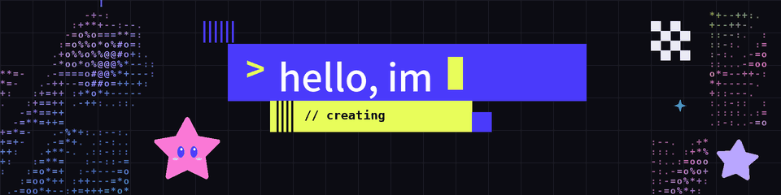
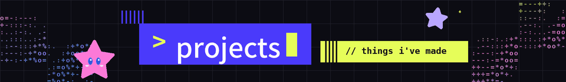

<p align="center">
  
</p>

### Hello! I'm Anne, and I like making things! (ﾉ◕ヮ◕)ﾉ*:･ﾟ✧

**Tech Intern** @ StellarPH  
**2nd Yr. Artificial Intelligence Engineering** @ Mapúa University Intramuros

I work across hardware and software, from robots that sense and move in the real world to the interfaces and servers behind them.

```
robotics                                          (•̀ᴗ•́)و
├─ embedded control, sensor integration, and computer vision
└─ c++ · python · arduino · raspberry pi · ros · opencv

web design & frontend                             (˶ᵔ ᵕ ᵔ˶)
├─ responsive interfaces, from figma prototype to production
└─ typescript · react · tailwind · figma · blender

backend                                           ( •̀ω•́ )✧
├─ rest apis, data models, workflow automations, and containerized deploys
└─ node.js · fastapi · postgresql · supabase · n8n · docker · aws
```

<br>

### tech stack ✧˖°

**ai & data**  


**robotics**  


**web & frontend**  


**backend**  


**cloud & deploy**  


**design & 3d**  


**tools**  


<br>

<p align="center">
  
</p>

<p align="center">im currently organizing them! (˶ˆᗜˆ˵)</p>

<br>

### fun facts 

- Currently learning how to better rice my Linux setup! I use CachyOS with Hyprland + Caelestia shell. Check out my [caelestia-shell](https://github.com/pannenama/caelestia-shell) repo for more. (Still a work in progress, I'm just a beginner!)
- I make art, from video editing and photography to design and illustration!
- Most, if not all, of my robotics projects are built from competition prizes and whatever I have lying around at home!
- I go on a lot of side quests. It's always fun to explore new opportunities and meet new people!
- Bicolano!

<br>

### say hi! (っ˘ω˘ς )

<a href="mailto:preciousannelabarete@gmail.com"></a>&nbsp;
<a href="https://www.linkedin.com/in/anne-labarete-16a66333b/"></a>

preciousannelabarete@gmail.com · [linkedin.com/in/anne-labarete](https://www.linkedin.com/in/anne-labarete-16a66333b/)

<p align="right"><sub>thanks for stopping by ⸜(｡˃ ᵕ ˂ )⸝♡</sub></p>
